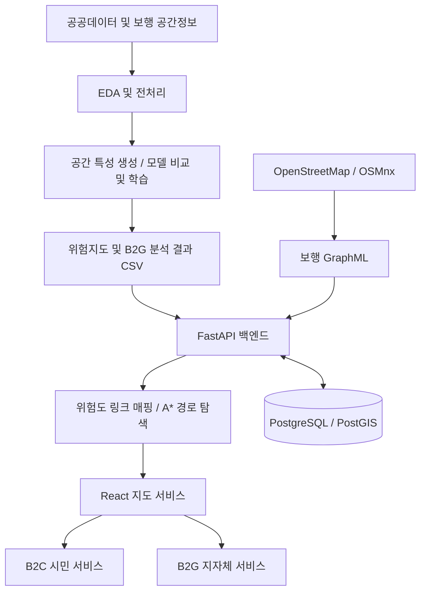

# 숨길 (Soom)

**시공간 데이터 기반 간접흡연 회피 도보 경로 안내 및 보건행정 지원 서비스**

숨길은 비흡연자의 보행 환경 선택을 돕고, 지자체의 흡연 관련 민원 관리와 보건정책 수립을 지원하는 팀 프로젝트입니다. 공공데이터, 머신러닝, 공간 분석 및 보행 네트워크를 결합하여 최단 경로와 상대적 흡연 위험 회피 경로를 제공합니다.

현재 서비스는 **서울특별시 강남구를 중심으로 개발된 프로토타입**입니다.

- [서비스 바로가기](https://soom-production-be127e6c.up.railway.app)
- [API 문서 (Swagger UI)](https://soom-backend-production.up.railway.app/docs)
- [API 상태 확인](https://soom-backend-production.up.railway.app/api/health)

> 아래 내용은 GitHub main 브랜치의 구현 기준입니다. 실제 운영 환경은 배포 승인 및 데이터 준비 상태에 따라 일부 기능이 다를 수 있습니다.

## 1. 주요 기능

### B2C | 시민용 간접흡연 회피 서비스

| 기능 | 설명 |
| --- | --- |
| 도보 경로 안내 | 출발지·도착지 기반 최단 경로와 위험 회피 경로 비교 |
| 회피 강도 설정 | 추가 보행 거리와 모델 위험 비용 사이의 균형 조절 |
| 지도 및 위치 | 현재 위치 동의 기반 표시, 주소 검색, 보행 경로 및 위험지역 시각화 |
| 흡연구역 안내 | 확인된 강남구 흡연구역 위치 표시 |
| 흡연 제보 | 위치 기반 제보 등록 및 관리자 승인 후 공개 |
| 반응형 UI | 데스크톱 및 모바일 화면 지원 |

### B2G | 지자체 보건행정 지원 서비스

| 기능 | 설명 |
| --- | --- |
| 청정지수 지도 | 보행 링크별 상대적 청정지수 시각화 |
| 제보 관리 | 관리자 제보 조회, 승인·반려 및 지도 확인 |
| 흡연시설 입지 후보 | DBSCAN 기반 적발 집중지역 분석 및 후보지 추천 |
| 어린이집 보호 우선순위 | 주변 모델 위험점수와 시설 정보를 활용한 보호 우선순위 분석 |
| 관리자 계정 관리 | 계정 신청, 제작자 승인·반려·비활성화 및 승인 이력 관리 |

관리자 전용 기능은 서버 인증을 요구합니다. 입지 후보는 현장 검토를 위한 참고 자료이며 시설 설치 허가나 법적 흡연 가능 여부를 의미하지 않습니다.

## 2. 시스템 구성



## 3. 데이터 분석 및 AI 모델

### 활용 데이터

| 구분 | 데이터 예시 | 활용 목적 |
| --- | --- | --- |
| 흡연 관련 | 강남구 흡연 단속·쓰레기 무단투기 적발, 마포구 담배꽁초 상습 투기지역 | 위험 모델 학습 및 검증 자료 |
| 생활인구 | 서울 생활인구 250m 격자 | 시간대별 인구 및 공간 특성 분석 |
| 상권·교통 | 상가·상권 정보, 버스정류소 | 주변 환경 특성 생성 |
| 보호시설 | 어린이집, 금연구역 | 보호 우선순위 및 입지 제한 분석 |
| 보행망 | 서울 도보 네트워크 공간정보, OpenStreetMap | 공간 분석 및 서비스 경로 탐색 |

### 모델링 흐름

1. 원본 데이터 EDA 및 좌표·공간 데이터 전처리
2. 보행 분석 지점별 특성 생성 및 공간 5-Fold 분할
3. Logistic Regression, Random Forest, XGBoost, LightGBM 등 후보 분류 모델 비교
4. 정밀도, 재현율, F1/F2, ROC-AUC 등 평가 지표를 활용한 모델 검토
5. 최종 모델 및 위험지도 CSV 생성
6. 위험지도와 보행 링크 결합, B2G 보호시설·입지 분석 결과 연동

마포구 외부 검증 및 임계값·모델 튜닝 관련 실험 코드도 별도로 관리합니다.

### 위험도와 경로 탐색

모델 위험점수는 꽁초 적발 기록과의 근접성에 관한 상대적 예측 지표입니다. 모델 결과를 보행 링크에 매핑하고 거리별 감쇠 정책을 적용합니다.

| 모델 지점과 링크 사이 거리 | 위험점수 반영 비율 |
| --- | ---: |
| 10m 이하 | 100% |
| 10m 초과 ~ 15m 이하 | 65% |
| 15m 초과 ~ 21m 이하 | 30% |
| 21m 초과 | 0% |

- 청정지수 = 100 − 보정 위험점수
- 링크 비용 = 링크 길이(m) × (1 + 회피 가중치 × 정규화 위험도)
- A* 알고리즘으로 위험 비용과 이동 거리를 고려한 회피 경로 탐색

위 감쇠율은 실측 연기 확산 결과가 아닌 임시 서비스 정책입니다. 청정지수는 실제 공기질, 담배 연기 농도 또는 개인의 간접흡연 노출 확률을 의미하지 않습니다.

## 4. 기술 스택

| 영역 | 기술 |
| --- | --- |
| Frontend | React, TypeScript, Vite, Tailwind CSS |
| Map | Leaflet, React Leaflet, CARTO |
| Backend | Python, FastAPI, Uvicorn, Pydantic |
| Database | PostgreSQL, PostGIS, psycopg |
| Data / ML | Pandas, NumPy, GeoPandas, SciPy, scikit-learn, XGBoost, LightGBM |
| GIS / Routing | OSMnx, NetworkX, Shapely, PyProj |
| Address API | Kakao, VWorld |
| Deployment / CI | Docker, Nginx, Railway, GitHub Actions |

## 5. 저장소 구조

```text
Soom/
├── app/
│   ├── backend/                 # FastAPI, 경로 탐색, 인증, 제보, 공간 분석 API
│   │   ├── sql/                 # DB 스키마 및 관리자 계정 테이블
│   │   ├── data/                # 서비스용 흡연구역 CSV
│   │   ├── main.py              # FastAPI 엔드포인트
│   │   ├── serve.py             # 운영용 진입점 / 보행망 비동기 준비
│   │   ├── walking_router.py    # 보행 네트워크 및 경로 계산
│   │   ├── safe_router.py       # 위험 회피 경로
│   │   ├── risk_mapper.py       # 보행 링크 위험도 매핑
│   │   └── requirements.txt
│   └── frontend/                # React 웹 서비스
│       ├── public/              # 지도 경계 및 UI 리소스
│       ├── src/                 # B2C / B2G 화면, 컴포넌트, API 연동
│       ├── Dockerfile
│       └── package.json
├── notebooks/
│   ├── 01_eda/                  # 데이터별 탐색적 분석
│   ├── 02_preprocessing/        # 좌표 변환 및 데이터 전처리
│   └── 03_modeling/
│       ├── 1_모델학습/
│       ├── 2_서비스/
│       ├── 3_선택/
│       ├── 4_실험/
│       └── 공통.py
├── src/                         # 데이터·특성·모델 관련 코드 구조
├── docs/                        # 기획 및 기능별 기술 문서
├── .github/workflows/           # 통합 검증 및 smoke test
├── Dockerfile                   # 백엔드 배포 이미지
├── requirements.txt             # 데이터 분석 및 모델링 의존성
└── README.md
```

## 6. 로컬 실행 (Windows PowerShell)

권장 환경: Python 3.12 (운영 백엔드 이미지 기준), Node.js 22, Git, PostgreSQL/PostGIS. 아래 명령은 저장소 루트에서 시작합니다.

### 6.1 저장소 및 Python 환경 준비

```powershell
git clone https://github.com/o-seonghwan/Soom.git
cd Soom
python -m venv .venv
.\.venv\Scripts\Activate.ps1
python -m pip install -r app/backend/requirements.txt
```

모델 학습까지 수행하려면 추가로 설치합니다.

```powershell
python -m pip install -r requirements.txt
```

### 6.2 백엔드 환경변수 및 데이터베이스

```powershell
Copy-Item app/backend/.env.example app/backend/.env
```

로컬 PostgreSQL/PostGIS 데이터베이스와 계정을 준비하고, 복사한 `.env`를 실제 접속 정보로 설정합니다. 필요한 경우 Kakao REST API 키도 서버 환경변수에 추가합니다.

| 환경변수 | 용도 |
| --- | --- |
| DB_HOST, DB_PORT, DB_NAME, DB_USER, DB_PASSWORD | DB 연결 |
| ADMIN_USERNAME, ADMIN_PASSWORD | 제작자 인증 |
| KAKAO_REST_API_KEY | 주소 검색 및 좌표 변환 |
| VWORLD_API_KEY | VWorld 관련 데이터 처리 |
| LUNG_RISK_CSV | 모델 위험지도 CSV 전체 경로 |
| LUNG_DBSCAN_RESULTS_DIR | DBSCAN 분석 결과 폴더 |
| LUNG_CHILDCARE_EXPOSURE_CSV | 어린이집 분석 결과 CSV |
| LUNG_SMOKING_ZONES_CSV | 확인된 흡연구역 CSV (선택) |

### 6.3 백엔드 실행

```powershell
python app/backend/init_db.py
python app/backend/download_network.py
cd app/backend
python -m uvicorn main:app --reload --port 8000
```

보행 그래프 기본 경로는 `data/processed/walking_network/gangnam_walk.graphml`입니다. 다운로드에는 외부 OSM/Overpass 서비스 연결이 필요합니다.

- API: http://localhost:8000
- Swagger UI: http://localhost:8000/docs
- Health: http://localhost:8000/api/health

### 6.4 프론트엔드 실행

새 PowerShell을 열고 저장소 루트에서 실행합니다.

```powershell
cd app/frontend
Copy-Item .env.example .env.local
npm ci
npm run dev
```

`.env.local`에 CARTO 지도 키와 백엔드 주소를 설정합니다.

```dotenv
VITE_CARTO_API_KEY=your_carto_basemap_key
VITE_API_BASE_URL=http://localhost:8000
```

브라우저에서 http://localhost:5173 접속.

> `VITE_` 환경변수는 브라우저 번들에 노출될 수 있으므로 서버 비밀키를 넣지 않습니다. 지도 키에는 제공업체에서 지원하는 사용 도메인 제한을 적용합니다.

## 7. 모델 학습 및 서비스 연동

원본 데이터와 EDA 결과는 별도 공유 데이터에서 준비합니다. 저장소를 복제하는 것만으로 전체 학습 데이터와 결과 CSV가 제공되는 것은 아닙니다.

저장소 루트에서 실제 데이터 경로를 지정합니다.

```powershell
$env:LUNG_DATA_ROOT = "C:\path\to\raw_data"
$env:LUNG_EDA_ROOT = "C:\path\to\processed_data"

python "notebooks/03_modeling/1_모델학습/0_머신러닝_전처리.py"
python "notebooks/03_modeling/1_모델학습/0_공간5Fold_분할.py"
python "notebooks/03_modeling/1_모델학습/1_B2C_비흡연자_간접흡연위험지도.py"
```

주소 좌표표가 필요하다면 사전에 VWorld 좌표 처리 스크립트와 해당 데이터 준비를 완료합니다. `LUNG_DRIVE_ROOT`를 통한 공유 데이터 폴더 지정도 지원합니다.

위험지도 생성 후 **백엔드를 실행하는 동일한 PowerShell**에서:

```powershell
$repo = (git rev-parse --show-toplevel).Trim()
$env:LUNG_RISK_CSV = Join-Path $repo "notebooks/03_modeling/결과/전처리기반/1_위험지도_지점.csv"
Test-Path $env:LUNG_RISK_CSV
```

백엔드를 실행하거나 재시작한 뒤 `/api/health`에서 `risk_source: model-csv`를 확인합니다.

- 위험 CSV 미설정 시 테스트용 Mock 위험 데이터가 사용됩니다.
- 위험 CSV를 지정했으나 유효하지 않은 경우 오류가 발생합니다.
- B2G 분석은 별도 결과 CSV가 필요하며, 자료가 없을 때 임의의 분석 결과를 제공하지 않습니다.
- 운영 환경에서 GraphML 준비 중에는 일부 경로 API가 503을 반환할 수 있습니다.

상세한 학습·분석 방법은 아래 기술 문서를 참고하세요.

## 8. 주요 API

| Method | Endpoint | 기능 |
| --- | --- | --- |
| GET | /api/health | 서비스 및 보행망 상태 |
| POST | /api/routes/shortest | 최단 경로 |
| POST | /api/routes | 최단·회피 경로 비교 |
| GET | /api/risks | 위험지도 |
| GET | /api/risks/edges | 링크 위험도 |
| GET | /api/smoking-zones | 흡연구역 |
| GET | /api/search-addresses | 주소 검색 |
| POST / GET | /api/reports | 제보 등록 / 공개 제보 조회 |
| GET | /api/b2g/cleanliness/edges | 보행 링크 청정지수 |
| GET | /api/b2g/dbscan/sites | 관리자용 입지 후보 |
| GET | /api/b2g/childcare/exposure | 관리자용 어린이집 보호 순위 |
| GET | /api/admin/me | 관리자 인증 확인 |
| GET / PATCH | /api/admin/reports (및 ID 경로) | 관리자 제보 관리 |
| POST / GET / PATCH | /api/admin/applications (및 ID 경로) | 관리자 신청 및 제작자 심사 |

## 9. 테스트 및 배포

프론트엔드 검증:

```powershell
cd app/frontend
npm ci
npm run build
npm run lint
```

저장소 루트에서 백엔드 회귀 테스트:

```powershell
python -m unittest discover -s app/backend -p "test_model_risk_integration.py" -v
python -m unittest discover -s app/backend -p "test_admin_approval.py" -v
python -m unittest discover -s app/backend -p "test_avoidance_simulation.py" -v
```

GitHub Actions는 프론트엔드 빌드·린트, Python 문법 및 주요 회귀 테스트, Notebook 형식 검사, 공개 API 및 프론트엔드 smoke test를 수행합니다. 전체 모델 학습과 실제 보행망을 사용한 종단 간 검증은 별도로 필요합니다.

Railway에서는 React/Nginx 프론트엔드, FastAPI 백엔드, PostgreSQL/PostGIS 데이터베이스를 분리하여 운영합니다. 운영 환경의 민감 변수는 GitHub에 저장하지 않습니다.

## 10. 기술 문서

| 문서 | 내용 |
| --- | --- |
| [모델 연동](docs/MODEL_INTEGRATION.md) | 위험 CSV 및 링크 위험도 |
| [회피 강도 시뮬레이션](docs/AVOIDANCE_SIMULATION.md) | 회피 비용 및 모의 검증 |
| [청정지수 지도](docs/B2G_CLEANLINESS_VISUALIZATION.md) | B2G 시각화 |
| [DBSCAN 입지 후보](docs/B2G_DBSCAN_SITE_RECOMMENDATIONS.md) | 후보 생성 및 연동 |
| [어린이집 보호 우선순위](docs/B2G_CHILDCARE_EXPOSURE_PRIORITY.md) | 시설별 분석 |
| [관리자 계정 승인](docs/ADMIN_ACCOUNT_APPROVAL.md) | 인증 및 승인 절차 |
| [강남구 흡연구역](docs/GANGNAM_SMOKING_ZONES_INTEGRATION.md) | 흡연구역 데이터 연동 |
| [지도 UI](docs/MAP_UI_DESIGN.md) | 지도 화면 구성 |
| [Railway 프론트엔드 배포](app/frontend/RAILWAY_DEPLOY.md) | 프론트엔드 배포 설정 |

## 11. 협업 및 데이터 관리

- 작업 시작 전 최신 main을 확인하고 기능별 브랜치에서 작업합니다.
- Pull Request 및 코드 검토를 거쳐 병합하는 것을 원칙으로 합니다.
- 대용량 원본·전처리 데이터와 모델 산출물은 별도 공유 저장소에서 관리합니다.
- 실제 비밀번호, API 비밀키, 사용자 위치·제보 관련 개인정보를 커밋하지 않습니다.
- 데이터 제공기관의 이용조건을 준수하고, 생성된 데이터의 출처와 버전을 기록합니다.

## 12. 프로젝트 한계 및 향후 방향

- 적발 기록은 흡연 발생의 대리 지표이며, 실제 흡연 여부와 일치하지 않을 수 있습니다.
- 위험점수 및 청정지수는 의료적 안전 판정이나 실시간 연기 센서 측정값이 아닙니다.
- 거리별 위험 감쇠와 회피 강도는 추가 현장 검증이 필요합니다.
- B2G 입지 추천은 실제 설치 결정 전 관련 법령·조례·현장 여건 검토가 필요합니다.
- 사용자 제보 품질 검증, 현장 데이터 수집, 위험 모델 재검증 및 운영 보안 강화는 지속적인 개선 과제입니다.
